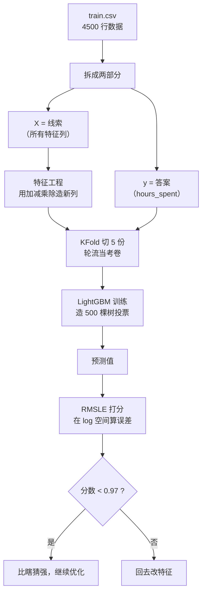

# 从零开始：Hack Club「工时侦探」比赛完全教程

> 写给：会一点点 Python、知道对数是什么但不太熟、完全没做过机器学习的人。
> 读完你应该能自己把整个比赛做完。

---

## 目录

1. [这个比赛到底在做什么](#1-这个比赛到底在做什么)
2. [X 和 y 到底是什么](#2-x-和-y-到底是什么)
3. [对数复习：它到底在干什么](#3-对数复习它到底在干什么)
4. [为什么这个比赛必须用对数](#4-为什么这个比赛必须用对数)
5. [RMSLE 是什么（不用求和符号版）](#5-rmsle-是什么不用求和符号版)
6. [代码里怎么写 RMSLE](#6-代码里怎么写-rmsle)
7. [模型是什么](#7-模型是什么)
8. [LightGBM 是什么](#8-lightgbm-是什么)
9. [超参数是什么](#9-超参数是什么)
10. [KFold 交叉验证是什么](#10-kfold-交叉验证是什么)
11. [inf 和 NaN 是什么](#11-inf-和-nan-是什么)
12. [特征工程是什么](#12-特征工程是什么)
13. [文字列怎么变成数字](#13-文字列怎么变成数字)
14. [完整流程清单](#14-完整流程清单)
15. [常见错误对照表](#15-常见错误对照表)

---

## 1. 这个比赛到底在做什么

想象一个场景：

> 学校有 4500 个同学，每人交了一份「学习记录」：
> 每天几点学、学了几页、做了几道题、笔记写了几页、有没有做作品……
>
> 老师根据这些记录，给每人打了一个「**实际学习小时数**」。
>
> 现在来了 500 个新同学，只给你他们的学习记录，
> **让你猜老师会给他们打多少小时。**

这就是比赛。对应关系：

| 故事里 | 比赛里 |
|---|---|
| 同学 | 一个 GitHub 项目 |
| 学习记录 | 代码提交数据（提交次数、代码行数、图片数……） |
| 老师打的小时数 | `hours_spent` 这一列 |
| 4500 个老同学 | `train.csv`（有答案，用来学习） |
| 500 个新同学 | `test.csv`（没答案，要你预测） |

**你要做的事**：写一个程序，输入一个项目的各种数据，输出一个数字（预测工时）。

---

## 2. X 和 y 到底是什么

这是最基础、也最容易卡住的一步。用一张表说清楚。

假设我们只有 4 个项目、3 个特征，数据长这样：

| project_id | num_commits | lines_of_code | num_image_files | **hours_spent** |
|---|---|---|---|---|
| aaa | 44 | 4600 | 8 | **32.2** |
| bbb | 9 | 800 | 0 | **5.0** |
| ccc | 12 | 1200 | 2 | **1.3** |
| ddd | 4 | 300 | 0 | **2.0** |

### y = 答案

`y` 就是**你要预测的那一列**，也就是 `hours_spent`。

```
y = [32.2, 5.0, 1.3, 2.0]
```

只有 4 个数，因为每个项目只有一个答案。

### X = 线索

`X` 就是**除了答案之外，所有能用来猜答案的列**。

```
X = [
  [44, 4600, 8],    ← aaa 的线索
  [ 9,  800, 0],    ← bbb 的线索
  [12, 1200, 2],    ← ccc 的线索
  [ 4,  300, 0],    ← ddd 的线索
]
```

注意形状：**4 行（4 个项目）× 3 列（3 个特征）**。

### 为什么叫 X 和 y

这是数学惯例：

- **X** 通常表示"输入"（大写，因为是很多列，像一个矩阵）
- **y** 通常表示"输出"（小写，因为只有一列，像一个向量）

### 哪些列不能放进 X

有四列必须删掉：

| 列名 | 为什么必须删 |
|---|---|
| `project_id` | 只是个随机编号，跟工时毫无关系。留着只会让模型学到"编号 aaa 的项目工时高"这种假规律 |
| `hours_spent` | **这是答案本身**，放进去等于考试抄答案 |
| `log_hours` | 是 `hours_spent` 取对数变的，等于答案的伪装版 |
| `hours_bucket` | 是 `hours_spent` 分箱变的（`<10`、`10-30`……），也是答案的伪装版 |

后三个叫 **数据泄漏（data leakage）**。

> **数据泄漏**：把答案的某种变形偷偷放进了线索里。
> 后果：本地测试分数好得离谱（比如 0.01），但真正交卷时 `test.csv` 里没有这列，程序直接崩，或者分数烂到 0.9。

**判断方法**：拿到一列，问自己「如果我不知道答案，我能算出这一列吗？」
- 能 → 可以当特征
- 不能（因为它就是从答案算出来的）→ 必须删

### 代码怎么写

```python
# 答案
y = df['hours_spent']

# 线索：从所有列里，删掉不能用的
X = df.drop(columns=['project_id', 'hours_spent', 'log_hours', 'hours_bucket'])

print(X.shape)   # 应该是 (4500, 69)
print(y.shape)   # 应该是 (4500,)
```

`(4500, 69)` 的意思是：4500 行，69 列特征。

---

## 3. 对数复习：它到底在干什么

你说知道对数，我们用最直白的方式过一遍。

### 定义

> **log 就是在问：「底数要几次方，才能得到这个数？」**

$$\log_{10}(1000) = 3 \quad\text{因为}\quad 10^3 = 1000$$

$$\log_{10}(100) = 2, \quad \log_{10}(10) = 1, \quad \log_{10}(1) = 0$$

### 核心作用：把「乘法差距」压成「加法差距」

| 原数 | 10 | 100 | 1000 | 10000 |
|---|---|---|---|---|
| log₁₀ | 1 | 2 | 3 | 4 |

原数从 10 涨到 10000，涨了 **1000 倍**；
但 log 只从 1 涨到 4，只差 **3**。

**这就是「压缩」**：大数字被压小，小数字相对被放大。

### 两种常见的 log

| 写法 | 名字 | 底数 | 用在哪 |
|---|---|---|---|
| $\log_{10}$ | 常用对数 | 10 | 中学课本 |
| $\ln$ | 自然对数 | $e \approx 2.718$ | 机器学习、这个比赛 |

**两者只是底数不同，性质完全一样。** 比赛用的是 $\ln$。

### 为什么是 ln(1+y) 而不是 ln(y)

因为工时最小是 0.1，如果直接 $\ln(0.1)$ 会得到负数；
更糟的是，万一有项目工时是 0，$\ln(0) = -\infty$（负无穷），程序会崩。

**加 1 就避开了这个问题**：$\ln(1+0) = \ln(1) = 0$，安全。

这个技巧叫 **log1p**（log of 1 plus），代码里就是 `np.log1p(y)`。

它的逆运算是 **expm1**，代码里是 `np.expm1(x)`，作用是把 log 还原回原数。

---

## 4. 为什么这个比赛必须用对数

看你的数据里 `hours_spent` 的范围：

```
最小 0.1 小时      最大 140.7 小时
```

差了 **1407 倍**。

现在假设有两个项目：

| 项目 | 真实工时 | 你猜的 | 差了几小时 |
|---|---|---|---|
| A | 1 小时 | 2 小时 | 1 小时 |
| B | 100 小时 | 101 小时 | 1 小时 |

**如果直接算「差了几小时」，这两个错误一样大（都是 1 小时）。**

但直觉上：
- A 错得离谱（猜成了 **2 倍**）
- B 几乎没错（只差 **1%**）

所以这个比赛**不看「差几小时」，而看「差几倍」**。

而「差几倍」正好可以用 log 表达：

$$\ln(2) - \ln(1) = 0.693 \quad\text{（A 的误差）}$$
$$\ln(101) - \ln(100) = 0.00995 \quad\text{（B 的误差）}$$

A 的误差是 B 的 **70 倍**。这才符合直觉。

> **一句话总结**：因为工时跨度太大（0.1 到 140），
> 用 log 把「倍数差距」变成「加减差距」，模型才好学。

---

## 5. RMSLE 是什么（不用求和符号版）

RMSLE = **R**oot **M**ean **S**quared **L**ogarithmic **E**rror
中文：均方根**对数**误差。

名字很长，我们拆成四步，用具体数字手算一遍。

### 先看一个更简单的：RMSE

假设你猜了 3 个项目：

| 项目 | 真实 | 你猜的 | 误差（猜 − 真） |
|---|---|---|---|
| A | 5 | 7 | +2 |
| B | 10 | 8 | −2 |
| C | 3 | 3 | 0 |

**第 1 步：误差平方**

为什么平方？因为 +2 和 −2 直接相加会抵消成 0，平方后都变正数。

$$2^2 = 4, \quad (-2)^2 = 4, \quad 0^2 = 0$$

**第 2 步：求平均（Mean）**

$$\frac{4 + 4 + 0}{3} = 2.67$$

**第 3 步：开根号（Root）**

因为刚才平方了，现在要还原单位。

$$\sqrt{2.67} \approx 1.63$$

所以 **RMSE ≈ 1.63**，意思是「平均每个项目猜错 1.63 小时」。

### 现在把 log 塞进去 = RMSLE

RMSLE 就是把上面三步里的「误差」，换成「**log 之后的误差**」。

**第 1 步：每个项目算「对数误差」**

先对真实值和预测值都取 $\ln(1+x)$，再相减：

| 项目 | 真实 | 预测 | $\ln(1+\text{真实})$ | $\ln(1+\text{预测})$ | 对数误差 |
|---|---|---|---|---|---|
| A | 5 | 7 | $\ln 6 = 1.7918$ | $\ln 8 = 2.0794$ | $-0.2877$ |
| B | 10 | 8 | $\ln 11 = 2.3979$ | $\ln 9 = 2.1972$ | $+0.2007$ |
| C | 3 | 3 | $\ln 4 = 1.3863$ | $\ln 4 = 1.3863$ | $0$ |

**第 2 步：平方**

$$(-0.2877)^2 = 0.0828$$
$$(0.2007)^2 = 0.0403$$
$$0^2 = 0$$

**第 3 步：全部加起来，除以项目数（这就是「平均」）**

$$0.0828 + 0.0403 + 0 = 0.1231$$
$$\frac{0.1231}{3} = 0.04103$$

**第 4 步：开根号**

$$\sqrt{0.04103} \approx 0.2026$$

所以 **RMSLE ≈ 0.203**。

### 对比一下

| 指标 | 结果 | 含义 |
|---|---|---|
| RMSE | 1.63 | 平均猜错 1.63 小时 |
| RMSLE | 0.203 | 平均猜错约 20%（按倍数算） |

### 那个 $\sum$ 符号是什么

公式里长这样：

$$\text{RMSLE} = \sqrt{\frac{1}{n}\sum_{i=1}^{n}\Big(\ln(1+y_i) - \ln(1+\hat{y}_i)\Big)^2}$$

$\sum$ 是希腊字母 sigma，意思是「**把每一项都加起来**」。

$$\sum_{i=1}^{n} a_i = a_1 + a_2 + a_3 + \dots + a_n$$

所以上面那个公式，翻译成大白话就是：

> 对每个项目 i：
> 1. 算 $\ln(1+\text{真实}_i) - \ln(1+\text{预测}_i)$
> 2. 平方
> 3. 把所有项目的这个值加起来
> 4. 除以项目总数 n
> 5. 开根号

**和你刚才手算的四步一模一样。** 公式只是把「手算」写成了符号。

### 分数怎么读

| RMSLE | 含义 |
|---|---|
| 0 | 完美，一个都没猜错 |
| 0.1 | 平均猜错约 10% |
| 0.5 | 平均猜错约 65% |
| **0.97** | **官方「瞎猜」基准线** |
| 1.0 | 平均猜错约 170% |

**你的目标：低于 0.97。** 低于这个数，说明你的模型比瞎猜强。

---

## 6. 代码里怎么写 RMSLE

因为评分是在 log 空间算的，所以**训练和预测必须成对使用 log**。

### 训练时

```python
model.fit(X_train, np.log1p(y_train))
```

把答案先取 log，再喂给模型。

### 预测时

```python
pred = np.expm1(model.predict(X_val))
```

模型吐出来的是 log 空间的值，必须用 `expm1` 还原成小时数。

### 打分时

```python
from sklearn.metrics import mean_squared_error

def rmsle(y_true, y_pred):
    # 两边都取 log1p，算 MSE，再开根号
    return np.sqrt(mean_squared_error(np.log1p(y_true), np.log1p(y_pred)))
```

### 三个必须记住的坑

| 坑 | 后果 |
|---|---|
| 用 `np.log` 而不是 `np.log1p` | 遇到 0.1 这种小值会出问题 |
| 忘了 `np.expm1` | 预测值全是 2~5，看起来「还行」其实全错 |
| 预测出负数 | 提交前要 `np.clip(pred, 0.1, None)` |

---

## 7. 模型是什么

模型就是一个**函数**：你喂给它特征，它吐出一个预测值。

$$\text{预测工时} = f(\text{提交次数}, \text{代码行数}, \text{图片数}, \dots)$$

「训练模型」= 让程序自己找出这个 $f$ 长什么样。

---

## 8. LightGBM 是什么

### 先说基础：决策树

决策树就是**一串 if-else**：

```
如果 代码行数 > 3000:
    如果 提交次数 > 20:
        预测 = 40 小时
    否则:
        预测 = 15 小时
否则:
    如果 有在线网站:
        预测 = 8 小时
    否则:
        预测 = 3 小时
```

就这么朴素。程序会自动找出「在哪个特征上切、切在哪、切完预测多少」。

### LightGBM = 很多棵树投票

- 一棵树容易犯错
- 造 500 棵树，让它们**投票平均**
- 错误互相抵消，结果就准了

这种「很多树投票」的方法叫**集成学习**（ensemble）。
LightGBM 是其中最快、最好用的一个，专门处理这种「表格数据」（csv 这种一行一行的数据）。

### 你只需要会三行

```python
model = LGBMRegressor()   # 造一个空模型
model.fit(X, y)           # 用数据训练它
model.predict(X_new)      # 用它预测
```

**不需要懂它内部怎么算。**

---

## 9. 超参数是什么

先分清两个词：

| | 谁决定的 | 例子 |
|---|---|---|
| **参数** | 模型**自己学**出来的 | 决策树里「切在 3000 行」这个 3000 |
| **超参数** | **你**手动设定的 | 「造 500 棵树」这个 500 |

**超参数 = 训练开始前，你自己拧的旋钮。**

LightGBM 的几个常见旋钮：

| 超参数 | 含义 | 类比 |
|---|---|---|
| `n_estimators` | 造多少棵树 | 请几个专家投票 |
| `learning_rate` | 每棵树的影响力 | 每个专家说话的分量 |
| `num_leaves` | 每棵树最多分几叉 | 每个专家考虑多细 |
| `min_child_samples` | 一个分支最少要几个样本 | 专家至少看几个案例才下结论 |

**「调参」** = 试不同的旋钮组合，看哪个分数最好。

> ⚠️ 调参的收益**远小于**特征工程。
> 新手常见错误是一上来就调参，其实先把特征做好收益大得多。

---

## 10. KFold 交叉验证是什么

### 先看问题

你切了 80% 训练、20% 验证。但这样有个毛病：

> **万一这 20% 恰好特别简单（或特别难），你的分数就不准了。**

就像考试只考一次，可能刚好考到你会的。

### KFold 的解法

把数据切成 **5 份**，然后**轮流当考卷**：

```
第 1 轮：用 2,3,4,5 训练 → 在 1 上考试 → 得分 s1
第 2 轮：用 1,3,4,5 训练 → 在 2 上考试 → 得分 s2
第 3 轮：用 1,2,4,5 训练 → 在 3 上考试 → 得分 s3
第 4 轮：用 1,2,3,5 训练 → 在 4 上考试 → 得分 s4
第 5 轮：用 1,2,3,4 训练 → 在 5 上考试 → 得分 s5

最终分数 = (s1 + s2 + s3 + s4 + s5) / 5
```

**好处**：每一行数据都当过一次考卷，分数更可信，不会因为「运气好」而虚高。

**「K」就是切几份**，K=5 是最常用的。

### 为什么必须固定 random_state

```python
KFold(5, shuffle=True, random_state=42)
```

- `shuffle=True`：先打乱顺序再切
- `random_state=42`：用 42 这个种子打乱

**种子固定 = 每次切出来的 5 份完全一样。**

为什么重要？因为你要比较「加了新特征后分数有没有变好」。
如果每次切法都不同，分数变化里就混了「切法不同」的干扰，你分不清是特征有用还是运气好。

**固定种子 = 控制变量**，这是做实验的基本功。

---

## 11. inf 和 NaN 是什么

### inf = infinity = 无穷大

通常来自**除以 0**：

```python
5 / 0   →  inf
```

特征工程里经常碰到，因为你要算比率：

```python
每次提交平均行数 = lines_of_code / num_commits
```

如果某个项目 `num_commits = 0`（一次都没提交），就变成 `5000 / 0 = inf`。

**inf 会让模型直接崩掉或算出垃圾结果。**

保护方法：把分母的最小值卡在 1。

```python
lines_of_code / max(num_commits, 1)
```

### NaN = Not a Number = 不是数字

表示「**这里没有数据**」。你的 csv 里就有：

```
page_weight_kb       有 1349 行是空的
num_js_files_loaded  有 1423 行是空的
```

空着的原因通常是：**这个项目没有在线网站**，所以没有网页大小、没有加载时间。

NaN 也要处理（填 0，或者单独标记「这里缺数据」），否则模型会报错。

### 检查方法

加完特征后固定跑一次：

```python
print(X.isna().sum().sum())                              # NaN 总数
print(np.isinf(X.select_dtypes('number')).sum().sum())   # inf 总数
```

**两个都必须是 0。**

---

## 12. 特征工程是什么

### 一句话定义

> **特征工程 = 用已有的列，算出新的列。**

比如你已经有 `lines_of_code`（总行数）和 `num_commits`（提交次数），
你可以算一个新列：

```
每次提交平均写多少行 = lines_of_code ÷ num_commits
```

这个新列就是「造出来的特征」。

### 为什么要造

因为「总行数 5000」这个信息不够精确：

- 5000 行分 100 次提交 → 慢慢做的项目
- 5000 行一次提交完 → 一次性上传（可能是抄的）

**同样的总行数，含义完全不同。** 造一个比率列，模型就能区分了。

### 铁律

> **特征工程唯一有效的判断标准：固定切分下的 CV RMSLE 有没有下降。**

不是「这个特征听起来合理」，不是「业务上说得通」，不是「重要性排名高」。**只有分数。**

### 工作流：一次只加一组

错误做法：「我想到 20 个特征，全加上看看」——分数涨了，但你不知道哪个有用。

正确做法：

```
基线分数 0.6649
  ↓ 加「比率特征」    → 0.6580  ✅ 保留
  ↓ 加「资产总量」    → 0.6582  ❌ 无提升，删掉
  ↓ 加「README 丰富度」→ 0.6551  ✅ 保留
  ↓ 加「缺失值指示列」→ 0.6503  ✅ 保留
  ↓ 加「交互特征」    → 0.6510  ❌ 变差，删掉
```

**每组改动都记一行**，最后这张表就是 README 里要写的「哪些特征有效」。

### 值得试的特征组（按收益排序）

#### 第 1 组：比率特征（收益最高）

| 新特征 | 公式 | 直觉 |
|---|---|---|
| `lines_per_commit` | `lines_added_total / num_commits` | 每次提交写多少 |
| `loc_per_file` | `lines_of_code / num_source_files` | 单文件平均长度 |
| `commits_per_active_day` | `num_commits / active_commit_days` | 提交密度 |
| `span_per_active_day` | `project_span_days / active_commit_days` | 拖了多久 vs 真干活几天 |

⚠️ 分母必须 `max(..., 1)`，否则会出 inf。

#### 第 2 组：注水信号（这是比赛主题）

题目叫「识破虚报工时的水项目」，这些特征直接对应考点：

| 新特征 | 逻辑 |
|---|---|
| `is_one_shot` | `pct_code_in_first_commit > 0.9`（你已经做了） |
| `is_zero_span` | `project_span_days == 0`（一天做完） |
| `low_commit_high_loc` | `num_commits <= 3 且 lines_of_code > 2000` |

#### 第 3 组：缺失值本身是信号

`page_weight_kb` 缺失 1349 行，说明**这个项目没有在线网站**。
而「有没有网站」是强信号（有网站的项目通常工时更高）。

所以不要急着填 0，先加指示列：

```python
df['has_website'] = df['page_weight_kb'].notna().astype(int)
```

**指示列 + 填充值，两个都要。**

#### 第 4 组：资产与 README 聚合

| 新特征 | 公式 |
|---|---|
| `total_assets` | 图片 + 音频 + 3D + 字体 文件数求和 |
| `readme_richness` | `readme_word_count*0.01 + readme_num_images + readme_num_code_blocks` |

#### 第 5 组：复杂度

```python
complexity = num_dependencies + num_languages*2 + num_directories*0.1
```

### 怎么判断「真的有用」而不是运气

**1. 换 seed 复测**

```python
for seed in [42, 2024, 7]:
    KFold(5, shuffle=True, random_state=seed)
```

三个 seed 都降才算真提升。

**2. 看提升幅度**

| delta | 判断 |
|---|---|
| > 0.005 | 确定有效 |
| 0.002 ~ 0.005 | 可能有效，换 seed 确认 |
| < 0.002 | 噪声，删掉 |

**3. 消融实验**

加完一组后，单独删掉其中一个特征，看分数掉多少。
掉得多 = 重要；不掉 = 冗余，可以删。

### 什么时候停

经验量级：

```
线性回归 baseline      ~0.77
树模型 baseline        ~0.66
特征工程做完           ~0.63 ~ 0.65
调参 + 模型融合        ~0.62 ~ 0.64
```

**连续 3 组特征都带来 < 0.002 的提升时，停手。**
继续堆特征只会过拟合 CV，线上反而变差。

---

## 13. 文字列怎么变成数字

模型只会算数，不会读文字。但你的数据里有这些列：

```
commit_cadence      = 'daily' / 'sporadic' / 'frequent'
primary_language    = 'TypeScript' / 'Python' / 'JavaScript' ...
framework           = 'nextjs' / 'godot' / 'unity' ...
hosting_type        = 'vercel' / 'itch' / 'github-pages' ...
project_category    = 'app' / 'game' / 'bot' / 'tool' ...
```

### 方法 1：序数映射（有大小顺序的）

`author_prior_projects` 的值是 `'0'`、`'1-2'`、`'3-5'`、`'6+'`。
这些**有大小顺序**，可以映射成数字：

```python
df['author_prior_projects'] = df['author_prior_projects'].map({
    '0': 0, '1-2': 1, '3-5': 2, '6+': 3
})
```

`author_account_age_years` 同理（`'<1'`、`'1-2'`、`'3-5'`、`'6+'`）。

### 方法 2：类别编码（没有大小顺序的）

`primary_language` 是 `'Python'`、`'TypeScript'`……这些**没有大小关系**，不能简单映射成 1、2、3（否则模型会以为 TypeScript > Python）。

两种做法：

**做法 A：让 LightGBM 自己处理（推荐）**

```python
for col in ['commit_cadence', 'primary_language', 'framework',
            'hosting_type', 'project_category']:
    X[col] = X[col].astype('category')
```

LightGBM 原生支持 `category` 类型，会自己学「Python 和 TypeScript 哪个工时高」。

**做法 B：One-Hot 编码**

把一列拆成很多列，每列是 0/1：

```
primary_language = 'Python'  →  is_python=1, is_ts=0, is_js=0
primary_language = 'TypeScript' →  is_python=0, is_ts=1, is_js=0
```

```python
X = pd.get_dummies(X, columns=['primary_language'])
```

**新手建议用做法 A**，代码少，效果通常更好。

### 方法 3：布尔列

`True`/`False` 转成 `1`/`0`：

```python
for col in X.columns:
    if X[col].dtype == bool:
        X[col] = X[col].astype(int)
```

⚠️ 注意有些列看起来是布尔，其实是**字符串** `'True'`/`'False'`（因为有空值）：

```
has_custom_art          有 2 个空值 → 读进来是 object 类型
is_mobile_responsive    有 1423 个空值 → object 类型
```

这些要单独处理：

```python
df['has_custom_art'] = df['has_custom_art'].map(
    {True: 1, False: 0, 'True': 1, 'False': 0}
)
```

---

## 14. 完整流程清单

### 阶段 0：合规（10 分钟）

- [ ] `.gitignore` 里加 `*.csv` 和 `.conda/`
- [ ] 确认 Hackatime 在跑
- [ ] 确认 Lapse 在录屏
- [ ] `git status` 里看不到任何 csv

### 阶段 1：Baseline（1 小时）

- [ ] 写 `rmsle()` 函数
- [ ] 定义 `X` 和 `y`，删掉 4 个泄漏列
- [ ] 布尔列转 0/1
- [ ] 序数列映射成数字
- [ ] 分类列转 `category`
- [ ] 5 折 CV + LightGBM，拿到第一个分数

**验收**：得到一个 CV RMSLE 数字，低于 0.97 就算赢过基准。

### 阶段 2：特征工程（2~3 小时）

- [ ] 一次加一组特征
- [ ] 每组记录分数变化
- [ ] 连续 3 组无提升就停

**验收**：分数比阶段 1 低，且知道是哪几个特征带来的。

### 阶段 3：调优（1~2 小时）

- [ ] 调 `num_leaves` / `learning_rate` / `min_child_samples`
- [ ] 试 CatBoost
- [ ] 两个模型加权平均

### 阶段 4：写 predict.py（1 小时）

评测机的契约：

```
同目录: train.csv, test.csv, predict.py
运行:   python predict.py
产出:   predictions.csv  (列名严格 project_id,hours_spent)
限制:   10 分钟, 断网
```

关键：**特征工程必须写成函数**，train 和 test 都调用同一个：

```python
def build_features(df):
    # 所有特征工程都在这里
    # 不能依赖 hours_spent（test.csv 没有这列）
    return X
```

**本地自测**：把 `val_part.csv` 删掉答案列、改名成 `test.csv`，跑 `python predict.py`，检查：

- [ ] 行数 == test.csv 行数
- [ ] 列名正好是 `project_id,hours_spent`
- [ ] 没有 NaN、没有负数

### 阶段 5：交卷 5 件套（2~3 小时）

| 件 | 最容易卡的地方 |
|---|---|
| GitHub 仓库 | 提交记录要高频，别一次性 push 完 |
| **Playable URL** | 必须 Vercel/Railway，**Streamlit/Render 不算** |
| Description | 写清楚试了哪些特征、哪些有效、CV 分数多少 |
| 截图 | 静态 PNG，不能 GIF |
| 工时证明 | Hackatime + Lapse |

> **Playable URL 是最容易拖垮整个提交的一项**，建议阶段 3 结束后就开始做。

---

## 15. 常见错误对照表

| 错误 | 症状 | 原因 |
|---|---|---|
| `NameError: name 'X' is not defined` | 报错 | 还没定义 X 就用了 |
| `could not convert string to float: 'daily'` | 报错 | 文字列没转成数字 |
| 分数 0.01（好得离谱） | 泄漏 | `log_hours` 或 `hours_bucket` 没删 |
| 预测值全是 2~5 | 忘了 `expm1` | 模型输出还在 log 空间 |
| 预测值有负数 | 没 clip | 加 `np.clip(pred, 0.1, None)` |
| `inf` 出现在特征里 | 除以 0 | 分母加 `max(..., 1)` |
| 本地 0.65，线上 0.9 | 特征不一致 | train/test 用了不同的特征工程代码 |
| 每次跑分数都不一样 | 没固定 seed | `random_state=42` |

---

## 附：一张图总结



---

## 附：术语速查表

| 术语 | 大白话 |
|---|---|
| 特征 / feature | 用来猜答案的线索（csv 的一列） |
| 标签 / target / y | 要预测的答案（`hours_spent`） |
| X | 所有特征组成的表格 |
| 模型 / model | 一个函数：喂线索，吐预测 |
| 训练 / fit | 让程序自己找出这个函数 |
| 预测 / predict | 用训练好的函数算新数据 |
| 特征工程 | 用加减乘除造新列 |
| 数据泄漏 | 答案的变形混进了线索里 |
| 超参数 | 训练前你自己拧的旋钮 |
| 调参 | 试不同旋钮组合 |
| KFold | 把数据切 K 份，轮流当考卷 |
| CV 分数 | KFold 算出来的平均分 |
| RMSLE | 在 log 空间算的误差，越小越好 |
| log1p | $\ln(1+x)$，防止 log(0) 崩掉 |
| expm1 | log1p 的逆运算，把 log 还原 |
| inf | 无穷大，通常是除以 0 |
| NaN | 没有数据（空值） |
| 过拟合 | 在训练数据上很好，新数据上很差 |

---

## 16. 补充答疑：求和符号、e、ln(1+y)、pandas

### 16.1 求和符号的上下标是什么

$$\sum_{i=1}^{n} a_i$$

三个部分：

| 位置 | 内容 | 含义 |
|---|---|---|
| 下面 | $i=1$ | **从第 1 项开始** |
| 上面 | $n$ | **到第 n 项结束** |
| 右边 | $a_i$ | 每一项长什么样 |

$i$ 是一个**计数器**，就像 for 循环里的变量：

```python
total = 0
for i in range(1, n + 1):   # 从 1 到 n
    total += a[i]
```

**举例**：$n=3$，$a = [0.0828,\ 0.0403,\ 0]$

$$\sum_{i=1}^{3} a_i = a_1 + a_2 + a_3 = 0.0828 + 0.0403 + 0 = 0.1231$$

**注意**：$i$ 只是个临时名字，写成 $k$、$j$ 都一样：

$$\sum_{k=1}^{n} a_k = \sum_{i=1}^{n} a_i$$

### 16.2 为什么是 ln(1+y)

**主要原因：防止 log(0)。**

$$\ln(0) = -\infty$$

如果某个项目工时是 0，直接取 log 就崩了。加 1 之后：

$$\ln(1+0) = \ln(1) = 0 \quad\text{（安全）}$$

**次要原因：小数值更稳定。**

当 $y$ 很小时（比如 0.1），$\ln(1+y) \approx y$，几乎等于原值，不会因为取 log 而剧烈变形。

**第三个原因：这是比赛规定的。**

评分公式写的就是 $\ln(1+y)$，你必须和它一致，否则分数对不上。

> 补充：你的数据里最小工时是 0.1，其实不加 1 也不会崩。
> 但比赛定义如此，而且加 1 更安全，所以照做。

### 16.3 e 是什么，为什么要用它

#### e 的数值

$$e \approx 2.718281828\dots$$

它是一个**无理数**（无限不循环小数），和 $\pi$ 一样是数学常数。

#### e 从哪来

想象银行利息：年利率 100%，一年结一次 → 1 变 2。
如果改成**每半年结一次**，利息也生利息 → 1 变 2.25。
每季度结一次 → 2.4414。
每月结一次 → 2.6130。
每天结一次 → 2.7146。
每秒结一次 → 2.71828…

**结息次数无限多时，结果趋近于 e。**

$$\lim_{n\to\infty}\left(1+\frac{1}{n}\right)^n = e$$

#### 为什么数学上偏爱 e

因为 $e^x$ 有一个别的底数都没有的性质：

$$\frac{d}{dx}e^x = e^x$$

**它的导数等于它自己。** 这让所有涉及「变化率」的公式都变得极简。

反过来，$\ln x$ 的导数也最干净：

$$\frac{d}{dx}\ln x = \frac{1}{x}$$

用别的底数（比如 10），导数会多出一个常数因子，公式变丑。

#### 关键结论：底数其实不影响排名

换底公式：

$$\log_b x = \frac{\ln x}{\ln b}$$

所以用 $\log_{10}$ 算的 RMSLE，和用 $\ln$ 算的，只差一个**固定倍数**：

$$\text{RMSLE}_{10} = \frac{\text{RMSLE}_{\ln}}{\ln 10} \approx \frac{\text{RMSLE}_{\ln}}{2.3026}$$

**所有队伍的分数会同时缩放，排名完全不变。**

那为什么比赛用 $\ln$？因为它是数学和机器学习里的默认约定，而且公式最简洁。

> **一句话**：e 是「让微积分公式最简洁」的那个底数。
> 你不需要会推导，只要知道 $\ln$ 就是「以 e 为底的对数」，代码里写 `np.log`。

### 16.4 你需要学 pandas 吗

**需要，而且必须。** 整个比赛 90% 的时间都在和 pandas 打交道。

但好消息是：**你只需要掌握 12 个操作**，不需要学完整本书。

#### 必会清单

| # | 操作 | 代码 | 用途 |
|---|---|---|---|
| 1 | 读文件 | `df = pd.read_csv('train.csv')` | 起点 |
| 2 | 看形状 | `df.shape` | 几行几列 |
| 3 | 看前几行 | `df.head()` | 肉眼检查 |
| 4 | 看类型和缺失 | `df.info()` | 哪些列是文字、哪些有空值 |
| 5 | 看统计量 | `df.describe()` | 最小值、最大值、均值 |
| 6 | 取一列 | `df['hours_spent']` | 得到 Series（一维） |
| 7 | 取多列 | `df[['a', 'b']]` | 得到 DataFrame（二维） |
| 8 | 删列 | `df.drop(columns=['x'])` | 删泄漏列 |
| 9 | 筛选行 | `df[df['num_commits'] > 10]` | 只看符合条件的 |
| 10 | 缺失值 | `df['x'].isna()` / `.fillna(0)` | 检查 / 填充 |
| 11 | 改类型 | `df['x'].astype(int)` | 文字转数字 |
| 12 | 存文件 | `df.to_csv('out.csv', index=False)` | 交卷 |

#### 进阶但很有用的 4 个

| # | 操作 | 代码 | 用途 |
|---|---|---|---|
| 13 | 分组统计 | `df.groupby('col')['hours_spent'].mean()` | 你已经用过 |
| 14 | 计数 | `df['col'].value_counts()` | 每类有多少个 |
| 15 | 映射替换 | `df['col'].map({'a': 1, 'b': 2})` | 序数编码 |
| 16 | 造新列 | `df['new'] = df['a'] / df['b']` | 特征工程核心 |

#### 不需要学的

- `merge` / `join`（这个比赛只有一个表）
- `pivot_table` / `MultiIndex`
- 时间序列（`resample`、`rolling`）
- `apply` 的高级用法（能用向量化就用向量化）

#### 一个必须养成的习惯

**pandas 的「链式赋值」陷阱**：

```python
# ❌ 可能不生效，还会报警告
df[df['a'] > 0]['b'] = 1

# ✅ 正确写法
df.loc[df['a'] > 0, 'b'] = 1
```

原因：`df[...]` 有时返回的是**副本**而不是原表，改副本不影响原表。

**新手建议**：造新列时直接用 `df['new'] = ...`，不要用链式索引。

#### 学习顺序建议

```
第 1 天：1~5（读、看、检查）        ← 你已经在做
第 2 天：6~9（取列、删列、筛选）
第 3 天：10~12（缺失、类型、存盘）
第 4 天：13~16（分组、映射、造列）  ← 特征工程需要
```

**不需要看完整教程**，遇到问题查官方文档的「10 minutes to pandas」那一页就够了。

---

## 17. 补充答疑：RMSLE 要懂到什么程度、groupby 怎么用

### 17.1 RMSLE 需要完全搞懂吗

**不需要。** 你只需要记住三件事：

1. **数字越小越好**，0 是完美，0.97 是官方瞎猜基准
2. **它是在 log 空间算的**，所以训练和预测必须成对用 `log1p` / `expm1`
3. **代码里直接调用现成函数**，不用自己手算

至于公式内部怎么推导，**完全不影响你做出一个好模型**。
就像你开车不需要懂发动机原理。

### 17.2 你的理解，对了几成

你说：

> 「输出的数字越小表示它猜的越准，就是真实的对数，减去猜的对数（ln）然后平方它，
> 然后把每一个这样的加起来处以每一个，最终的出的结果就是平均的误差？」

**大方向对了，但有 4 处要修正。**

| 你说的 | 正确说法 | 差别 |
|---|---|---|
| 真实的对数 | $\ln(1+\text{真实})$ | 是「加 1 再取 log」，不是直接取 log |
| 减去猜的对数 | 减去 $\ln(1+\text{预测})$ | 同样要加 1 |
| 平方它 | 平方它 ✅ | 对 |
| 加起来除以每一个 | 加起来**除以项目总数 n** | 「每一个」说法含糊，是除以「有几个项目」 |
| 结果就是平均的误差 | 结果还要**开根号** | 你漏了最后一步 |

### 17.3 完整四步（修正版）

```
第 1 步：每个项目算  ln(1+真实) - ln(1+预测)
第 2 步：每个都平方
第 3 步：全部加起来，除以项目总数 n
第 4 步：开根号          ← 你漏了这步
```

### 17.4 为什么要开根号

因为第 2 步平方了，数字的「单位」被破坏了。

举个简单例子：

```
误差是 2 小时
平方后 = 4（单位变成「小时的平方」，没有实际意义）
开根号 = 2（还原成「小时」）
```

RMSLE 里也一样：平方后是「log 单位的平方」，开根号才还原成「log 单位」。

**所以它叫 Root（开根）Mean（平均）Squared（平方）Logarithmic（对数）Error——名字就是四步的倒序。**

### 17.5 一句话记住

> **RMSLE = 把真实值和预测值都取 log，算它们的差距，平方、平均、开根号。**
> **数字越小越好，低于 0.97 就赢过瞎猜。**

---

### 17.6 groupby 是什么

#### 一句话

> **groupby = 按某一列的值，把行分成几堆，然后对每堆做一个计算。**

#### 用你自己的代码看

你 notebook 第 8 格跑过这个：

```python
result = df.groupby("is_one_shot")["hours_spent"].agg(["count", "mean", "median"])
print(result)
```

输出：

```
             count      mean  median
is_one_shot
False         3731  13.399544     7.0
True           769   6.006632     3.0
```

#### 它在干什么

`is_one_shot` 这一列只有两个值：`True` 和 `False`。

groupby 做的事：

```
把 4500 行按 is_one_shot 分成两堆：

  堆 1（False）：3731 行
  堆 2（True） ： 769 行

然后对每一堆，算 hours_spent 的：
  count  = 有几行
  mean   = 平均值
  median = 中位数
```

#### 生活类比

> 把全班同学按「性别」分成两堆，然后算每堆的平均身高。

```python
班级.groupby("性别")["身高"].mean()
```

输出：

```
性别
男    175.2
女    162.8
```

就这么简单。

#### 语法拆解

```python
df.groupby("is_one_shot")["hours_spent"].agg(["count", "mean", "median"])
   └──────┬──────┘  └─────┬─────┘  └──────────┬──────────┘
      按这列分组      只关心这列        对每堆算这三个
```

三部分：

| 部分 | 作用 |
|---|---|
| `.groupby("列名")` | 按这列的值分组 |
| `["另一列"]` | 只对另一列做计算 |
| `.agg([...])` | 要算哪些统计量 |

#### 更简单的写法

如果只算一个统计量，可以省略 `.agg`：

```python
df.groupby("is_one_shot")["hours_spent"].mean()
```

输出：

```
is_one_shot
False    13.399544
True      6.006632
```

#### 这个结果告诉你什么

**一次性上传的项目（`is_one_shot=True`），平均工时只有 6 小时；
正常分多次提交的项目，平均 13.4 小时。**

这就是「识破注水项目」的第一个证据：
一次性上传的项目，审核员批的工时明显更低。

#### groupby 在比赛里怎么用

**主要用途：探索数据，发现规律。**

比如你可以试：

```python
# 不同项目类型的平均工时
df.groupby("project_category")["hours_spent"].mean()

# 不同语言的
df.groupby("primary_language")["hours_spent"].mean()

# 有没有在线网站的
df.groupby("url_is_live")["hours_spent"].mean()
```

**注意**：groupby 的结果**不能直接当特征用**（那会泄漏）。
它的作用是**帮你发现「哪个特征值得放进模型」**。

比如你发现 `project_category` 分组后工时差异很大，
那就说明 `project_category` 是个有用的特征，应该放进 X。

#### 一句话总结

> **groupby = 分组 + 统计。用来「看看不同类别的项目有什么不同」。**

---

## 18. 为什么是 70 列，以及文字列怎么处理

### 18.1 列数对账

```
原始 train.csv              73 列
+ 你在第 7 格造的 is_one_shot  +1
- drop 掉的 4 列              -4
────────────────────────────────
= 70 列  ✅ 正确
```

所以 `(4500, 70)` 是对的，不是 69。我上次说 69 是忘了你已经加过 `is_one_shot`。

**验证方法**：随时可以自己数一遍

```python
print(df.shape[1])          # 原始列数
print(len(X.columns))       # 现在 X 的列数
print(X.columns.tolist())   # 逐列看名字
```

### 18.2 X 里现在有 12 个文字列

```python
[c for c in X.columns if X[c].dtype == object]
```

输出：

```
['commit_cadence', 'primary_language', 'framework', 'has_custom_art',
 'hosting_type', 'is_mobile_responsive', 'project_category',
 'is_multiplayer', 'mentions_ai_api', 'is_clone_or_tutorial',
 'author_prior_projects', 'author_account_age_years']
```

**模型只会算数，不会读文字。** 这 12 列必须全部变成数字，否则会报：

```
ValueError: could not convert string to float: 'daily'
```

### 18.3 这 12 列分成 3 类，处理方式完全不同

#### 第 1 类：假布尔（看起来是 True/False，其实是字符串）

| 列名 | 为什么是字符串 |
|---|---|
| `has_custom_art` | 有 2 个空值 |
| `is_mobile_responsive` | 有 1423 个空值 |
| `is_multiplayer` | 有 5 个空值 |
| `mentions_ai_api` | 有 3 个空值 |
| `is_clone_or_tutorial` | 有 5 个空值 |

**原因**：pandas 读 csv 时，如果一列里既有 `True`/`False` 又有空值，
它没法用 bool 类型表示空值，就整列退化成字符串 `'True'`/`'False'`。

**处理**：映射成 1/0，空值填 0

```python
for col in ['has_custom_art', 'is_mobile_responsive', 'is_multiplayer',
            'mentions_ai_api', 'is_clone_or_tutorial']:
    X[col] = X[col].map({True: 1, False: 0, 'True': 1, 'False': 0})
```

⚠️ 注意 `map` 里要同时写 `True` 和 `'True'`，因为不同列可能类型不同。

#### 第 2 类：序数（有大小顺序）

| 列名 | 值 | 映射 |
|---|---|---|
| `author_prior_projects` | `'0'`, `'1-2'`, `'3-5'`, `'6+'` | 0, 1, 2, 3 |
| `author_account_age_years` | `'<1'`, `'1-2'`, `'3-5'`, `'6+'` | 0, 1, 2, 3 |

**为什么可以映射成数字**：因为「6+ 个历史项目」确实比「0 个」多，
数字大小关系是有意义的。

```python
X['author_prior_projects'] = X['author_prior_projects'].map(
    {'0': 0, '1-2': 1, '3-5': 2, '6+': 3}
)
X['author_account_age_years'] = X['author_account_age_years'].map(
    {'<1': 0, '1-2': 1, '3-5': 2, '6+': 3}
)
```

#### 第 3 类：真分类（没有大小顺序）

| 列名 | 值的个数 | 例子 |
|---|---|---|
| `commit_cadence` | 3 | `daily` / `sporadic` / `frequent` |
| `primary_language` | 22 | `Python` / `TypeScript` / ... |
| `framework` | 18 | `nextjs` / `godot` / `unity` / ... |
| `hosting_type` | 17 | `vercel` / `itch` / `github-pages` / ... |
| `project_category` | 6 | `app` / `game` / `bot` / `tool` / ... |

**为什么不能简单映射成 1、2、3**：
如果 `Python=1`、`TypeScript=2`，模型会以为「TypeScript 比 Python 大」，
但语言之间根本没有大小关系。

**两种正确做法**：

**做法 A：交给 LightGBM 自己处理（推荐新手）**

```python
for col in ['commit_cadence', 'primary_language', 'framework',
            'hosting_type', 'project_category']:
    X[col] = X[col].astype('category')
```

`astype('category')` 告诉 pandas「这列是分类，不是普通文字」。
LightGBM 看到 `category` 类型，会自己学「Python 和 TypeScript 哪个工时高」。

**做法 B：One-Hot 编码**

把一列拆成很多 0/1 列：

```
primary_language = 'Python'      →  is_python=1, is_ts=0, is_js=0
primary_language = 'TypeScript'  →  is_python=0, is_ts=1, is_js=0
```

```python
X = pd.get_dummies(X, columns=['primary_language'])
```

缺点：22 种语言会变成 22 列，列数暴涨。

**新手用做法 A。**

### 18.4 布尔列也要转

X 里还有 13 个真正的 bool 列：

```python
[c for c in X.columns if X[c].dtype == bool]
```

```
['uses_game_engine', 'has_tests', 'has_ci_config', 'has_dockerfile',
 'has_backend', 'has_database', 'readme_has_install_instructions',
 'has_license', 'has_docs_folder', 'url_is_live', 'has_custom_domain',
 'is_forked_from_template', 'is_one_shot']
```

虽然 LightGBM 能处理 bool，但统一转成 0/1 更保险：

```python
for col in X.columns:
    if X[col].dtype == bool:
        X[col] = X[col].astype(int)
```

### 18.5 处理完怎么验证

```python
# 1. 还有没有文字列？
print([c for c in X.columns if X[c].dtype == object])
# 应该输出 []（空列表）

# 2. 还有没有 NaN？
print(X.isna().sum().sum())
# 应该输出 0

# 3. 还有没有 inf？
import numpy as np
print(np.isinf(X.select_dtypes('number')).sum().sum())
# 应该输出 0
```

**三个都通过，X 才算准备好。**

### 18.6 顺序很重要

```
1. 先处理假布尔（map 成 1/0）
2. 再处理序数（map 成 0~3）
3. 再处理真分类（astype('category')）
4. 最后统一把 bool 转 int
```

如果顺序反了，比如先 `astype(int)` 再 `map`，
字符串 `'True'` 转 int 会直接报错。

### 18.7 一个容易忽略的点

`astype('category')` 之后，**训练集和测试集的类别必须一致**。

如果 train 里有 `'Python'`，test 里有 `'Rust'`（train 里没有），
LightGBM 会报错或把它当缺失值。

**解决办法**：在 `build_features` 函数里，用 train 的类别去对齐 test：

```python
# 训练时记下类别
categories = {col: X_train[col].cat.categories for col in cat_cols}

# 预测时对齐
for col in cat_cols:
    X_test[col] = pd.Categorical(X_test[col], categories=categories[col])
```

这个坑在阶段 4 写 `predict.py` 时一定会遇到，先记着。
